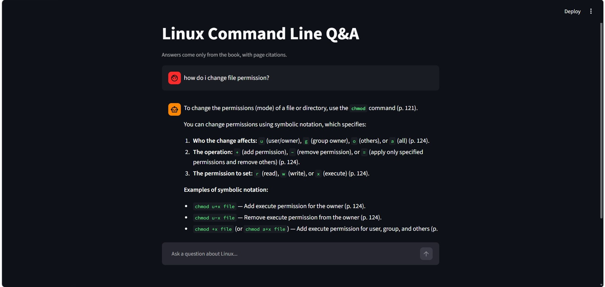

# Linux Command Line Q&A (RAG)

A question-answering app over the book _The Linux Command Line_ by William Shotts. Ask a question in plain English and get an answer grounded in the book, with page citations. If the book doesn't contain the answer, it says "I don't know" instead of guessing.

I built this as my first RAG (Retrieval-Augmented Generation) project to learn how retrieval and an LLM work together.



## How it works

```
PDF -> pages -> chunks -> embeddings -> Chroma vector DB
                                              |
Question -> embedding -> top-6 similar chunks -+
                                              |
        prompt = instructions + chunks + question
                                              |
                     Gemini -> answer with page citations
```

1. **Load:** extract text from the PDF page by page with `pypdf`.
2. **Chunk:** split each page into ~1500-character chunks with overlap, keeping the page number as metadata.
3. **Embed:** convert chunks to vectors with `all-MiniLM-L6-v2` (sentence-transformers).
4. **Store:** save vectors in a local Chroma database.
5. **Retrieve:** embed the question and fetch the 6 closest chunks.
6. **Generate:** send the chunks and the question to Gemini with the instruction to answer only from the context and cite pages.
7. **Retry:** if the API returns 503 or 429, the app retries with increasing waits and falls back to a second model.

## Tech stack

Python, pypdf, sentence-transformers, ChromaDB, Google Gemini API (free tier), Streamlit

## Setup (Windows)

1. Clone the repo and open the folder:
   ```
   git clone https://github.com/nandanap24/linux-rag.git
   cd linux-rag
   ```
2. Create and activate a virtual environment:
   ```
   python -m venv venv
   venv\Scripts\activate
   ```
3. Install dependencies:
   ```
   pip install -r requirements.txt
   ```
4. Download the book (free, Creative Commons) from [linuxcommand.org](https://linuxcommand.org/tlcl.php), create a `data` folder, and save the PDF as `data/linux_command_line.pdf`.
5. Get a free API key from [Google AI Studio](https://aistudio.google.com) and create a `.env` file:
   ```
   GEMINI_API_KEY=your_key_here
   ```
6. Run the app:
   ```
   streamlit run app.py
   ```
   The first run builds the index, which takes a few minutes. After that it starts quickly.

## Evaluation

I tested the app on a small question set (`eval/questions.json`). Run it with:

```
python eval/run_eval.py
```

Results are saved to `eval/results.csv`.

| Metric                                   | Result      |
| ---------------------------------------- | ----------- |
| Answerable questions answered correctly  | 6 / 8    |
| Unanswerable questions correctly refused | 2 / 2    |
| Expected page found in retrieved chunks  | 3 / 3 |

I checked each answer by hand against the book. One question failed because the Gemini API was busy; it is counted as not answered. One question (grep) was refused, probably because that chapter is outside the indexed pages (20-150).

## What I learned

- Chunk size matters: larger chunks fixed an answer that was cut off mid-explanation.
- Retrieval ranking isn't perfect. A basic vector search sometimes ranks a less useful chunk first.
- The prompt controls hallucination. Telling the model to answer only from the context makes it refuse out-of-scope questions.
- When an answer is bad, check retrieval first (right chunks?), then generation (right chunks, wrong answer?).
- Free APIs fail sometimes, so retries and fallbacks are needed.

## Limitations

- Only pages 20-150 of the book are indexed, so later chapters (for example `grep`) are not covered.
- Pure vector search: no reranking or keyword matching.
- The evaluation set is small (10 questions) and checked manually.
- Answers depend on the free Gemini tier, which has rate limits and can be unavailable at busy times.

## Next steps

- Add reranking and hybrid (BM25 + vector) search, then compare scores with this version
- Index the full book
- Add automatic evaluation metrics (for example RAGAS)
- Deploy to Hugging Face Spaces
